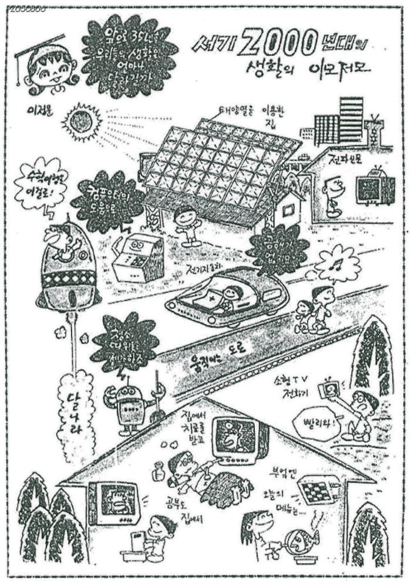

# Welcome to E26-AI01-11

## 🎯 팀 슬로건
> 좋아하는 일을 찾자

## 🖼️ 팀 포스터
<p align="center">
  
</p>

<p align="center">
  <sub>
    포스터 참고 자료:
    <a href="https://www.superookie.com/contents/59e36fc88b129f15c76d92bf">
      슈퍼루키 - 좋아하는 일을 찾는 방법
    </a>
  </sub>
</p>


***

## 1️⃣ 팀원 소개

| **이름** | **전공** | **관심사** |
| --- | --- | --- |
| **최승한** | 인공지능학부 | |
| **박서연** | 인공지능학부 | |
| **조현우** | 인공지능학부 | |
| **이지훈** | 인공지능전공 | 패션, 자기 자신을 가꾸는 것, 독서 |
| **홍현서** | 인공지능전공 | 여행, 자기 관리 |

2026-10-16 팀 재편으로 E26-AI01-08 팀(이지훈·홍현서)이 합류했습니다. 아래 활동 내역은 두 팀이 각각 작성한 내용을 합친 것입니다.


### 팀 소개


***

## 2️⃣ 공통된 관심사 : 자기 관리

***

## 3️⃣ 한학기 동안의 활동 내역 

-9/18 week 1
  - mission 1
  - 실현됨 :
  - 개인이 휴대용 컴퓨터를 가지고 다닌다. // 스마트폰이 컴퓨터·전화·카메라 등의 기능을 통합
  - 인공지능이 인간의 언어를 이해하고 대화한다. // 생성형 AI와 음성 AI가 자연어 대화를 수행
  - 일부 실현 :
  - 자동으로 운전하는 자동차가 등장한다. // 기술적으로 실현됐지만 아직 책임 관련한 법적 문제가 해결되지 않아 완전히 실현되지 못함.
  - 무인 비행기가 인간의 일을 대신한다. // 드론이 촬영·배송·농업·군사 등에서 활용되지만 모든 항공 업무를 대체하지는 못함.
  - 아직 미실현:
  - 순간이동으로 사람이나 물체를 이동시킨다. // 양자 상태의 순간이동 연구는 있지만 사람이나 물체의 순간이동은 불가능
  - 방향 전환 : 종이신문이 사라지고 전자신문으로 대체된다. // 종이신문은 감소했지만, 웹사이트·뉴스 앱·SNS·유튜브 등으로 뉴스 소비가 분산됨
  - mission 2
  - 인공지능이 인간의 언어를 이해하고 대화한다
    - why. 해결하려 했던 문제
         컴퓨터를 사용하려면 프로그래밍 언어와 같은 전문적인 지식이 필요했다. 사람들은 누구나 쉽게 컴퓨터를 사용할           수 있도록 인간의 자연어를 컴퓨터가 이해하는 기술을 꿈꿨다.
    - what. 꿈꾼 미래 모습
        사람이 컴퓨터의 사용법을 따로 배우지 않고, 일상적인 언어로 컴퓨터와 대화하며 원하는 작업을 수행하는 미래를           상상했다.
    - how. 현재의 실현 모습
        자연어 처리와 딥러닝 기술의 발전으로 음성 AI와 생성형 AI가 등장했다. 현재는 질문에 답하거나 글을 작성하고,         정보를 정리하고, 코드를 생성하는 등 자연어를 이용해 다양한 작업을 수행할 수 있다. 다만 과거에 상상했던 인간         형 컴퓨터보다는 스마트폰·PC·웹서비스 등에 AI가 탑재되는 형태로 발전했다.
    - next. 아직 해결하지 못한 문제
        AI의 발전과 함께 잘못된 정보 생성, 개인정보 및 저작권 문제, AI가 생성한 결과에 대한 책임 문제, 일자리 변         화와 AI 의존성 등의 윤리적·사회적 문제가 나타나고 있다. 따라서 인간의 언어를 이해하는 기술 자체는 실현되었         지만, 이를 ​안전하고 책임 있게 사용하는 방법은 아직 해결해야 할 과제로 남아 있다.

-9/18 week 1 (구 팀11 작성)
  - 과거에 사람들이 꿈꾼 세상 과제
  - 선택한 과거 미래 사례명 및 핵심 상상 내용: 스타트렉의 "범용 번역기", 서로 다른 언어를 즉시 이해하고 자연스럽게 대화하는 기술.
  - 현재 기술 상태와 4분류 결과: AI 실시간 음성번역기 등장했지만 정확도와 맥락 이해에 한계가 있어 "일부 실현"으로 분류하였음.
  - 분류 근거와 현실화/변화 과정에서의 주요 이유: 딥러닝, 대규모 언어데이터, 컴퓨팅 성능의 발전으로 현실화됐지만 문화, 뉘앙스, 전문용어까지 완벽히 번역하기는 어려움.
  - 논의 과정에서 도출된 우리 팀의 핵심 질문: 실시간 번역이 완벽해진다면 외국어를 직접 배우는 것은 여전히 필요할까?

-10/2 week 2

 - idea 1 팀플 일정, 역할 관리
   - 다수의 사람이 참여하는 공동 작업에서 일정과 업무를 효율적으로 조율하기 어렵다.
   - 필요성: 많은 학생들이 겪는 문제라고 생각
   - 새로움: 아직 대표적인 서비스는 없지만 많은 도전이 있었던 것으로 알고 있음
   - 실현가능성: 빈 일정과 공간을 알아서 추천해주더라도 팀플에서의 문제는 보통 팀원들의 참여도이기 때문에 크게 유의미한 결과를 보일 것 같지 않음
   - 위험 요소: 팀원들의 참여도
 
 - idea 2 학교 내 물품 대여
   - 짧은 시간 동안 필요한 자원을 개인이 효율적으로 공유하기 어렵다.
   - 필요성: 매우 필요하다고 생각
   - 새로움: 이미 소프트웨어 융합대학에 '빌릴게' 서비스 존재
   - 실현가능성: 쉬운 편에 속함
   - 위험 요소: 반납, 자원 관리
 
 - idea 3 공강시간 활용
   - 제한된 시간과 자원을 개인의 상황에 맞게 효율적으로 활용하기 어렵다.
   - 필요성: 개인의 역량에 따라 자신의 시간을 활용하는 역량이 매우 차이남. 공강 시간을 제대로 활용하지 못하는 학생들에게 필요할 것으로 예상
   - 새로움: 관련된 내용을 본 적 없음
   - 실현가능성: 인스타, 유튜브 같은 플랫폼이 알고리즘을 통해 사용자의 개인 관심 분야를 추천하는 것 처럼 공강 시간에 할 수 있는 활동을 알고리즘을 통해 추천해 줄 수 있을 것 같음
   - 위험 요소: 개인 정보 보호 문제

 - final idea
   - 3 공강시간 활용
   - why: 필요, 새로음, 실현 가능성이 종합적으로 높다고 판단.
   - next step: 구현하기 위해서 필요한 요소, 위험요소를 해결하기 위한 방안은 무엇일까?
  

-10/16 3 week
|---|---|
| 제목 및 요약 |......|
| 문제 정의(불편함,필요성) |......|
| 언제: 어디서: 누가: 왜: 어떻게: | ......|
| 주요 사용자(or 이해관계자) |......|
| 미래 장면(사용자가 느끼는 경험, before&after) |......|
| 서비스 작동 방식 |.....|
| 검증 질문 |.....|

| 팀 및 역할 | 퍼실리테이터: 사용자 관찰자: 기록자: 시각화 담당: |


<!-- 활동 사진 추가 예시 -->


***

## 4️⃣ 인상 깊은 활동

- 활동명 – 활동에 대한 간단한 설명과 배운 점을 작성  
- 예: 멘토링에서 실리콘밸리 현업 경험을 들을 수 있어 진로 방향 설정에 큰 도움이 되었다.  

***

## 5️⃣ 특별히 알아보고 싶은 것
- 예: 현장실습 제도
- 예: 학부 졸업 인증 조건
- 예: 성취기반평가
- 예: 졸업 후 진로(대학원/취업)

***

## 6️⃣ 활동을 마친 소감

🔗학번 이름  
> "소감 내용을 여기에 작성합니다."

🔗학번 이름  
> "소감 내용을 여기에 작성합니다."

🔗학번 이름  
> "소감 내용을 여기에 작성합니다."

🔗학번 이름  
> "소감 내용을 여기에 작성합니다."

🔗학번 이름  
> "소감 내용을 여기에 작성합니다."


## Markdown을 사용하여 내용꾸미기를 익히세요.

Markdown은 작문을 스타일링하기위한 가볍고 사용하기 쉬운 구문입니다. 여기에는 다음을위한 규칙이 포함됩니다.

```markdown
Syntax highlighted code block

# Header 1
## Header 2
### Header 3

- Bulleted
- List

1. Numbered
2. List

**Bold** and _Italic_ and `Code` text

[Link](url) and 
```

자세한 내용은 [GitHub Flavored Markdown](https://guides.github.com/features/mastering-markdown/).

### Support or Contact

readme 파일 생성에 추가적인 도움이 필요하면 [도움말](https://help.github.com/articles/about-readmes/) 이나 [contact support](https://github.com/contact) 을 이용하세요.

